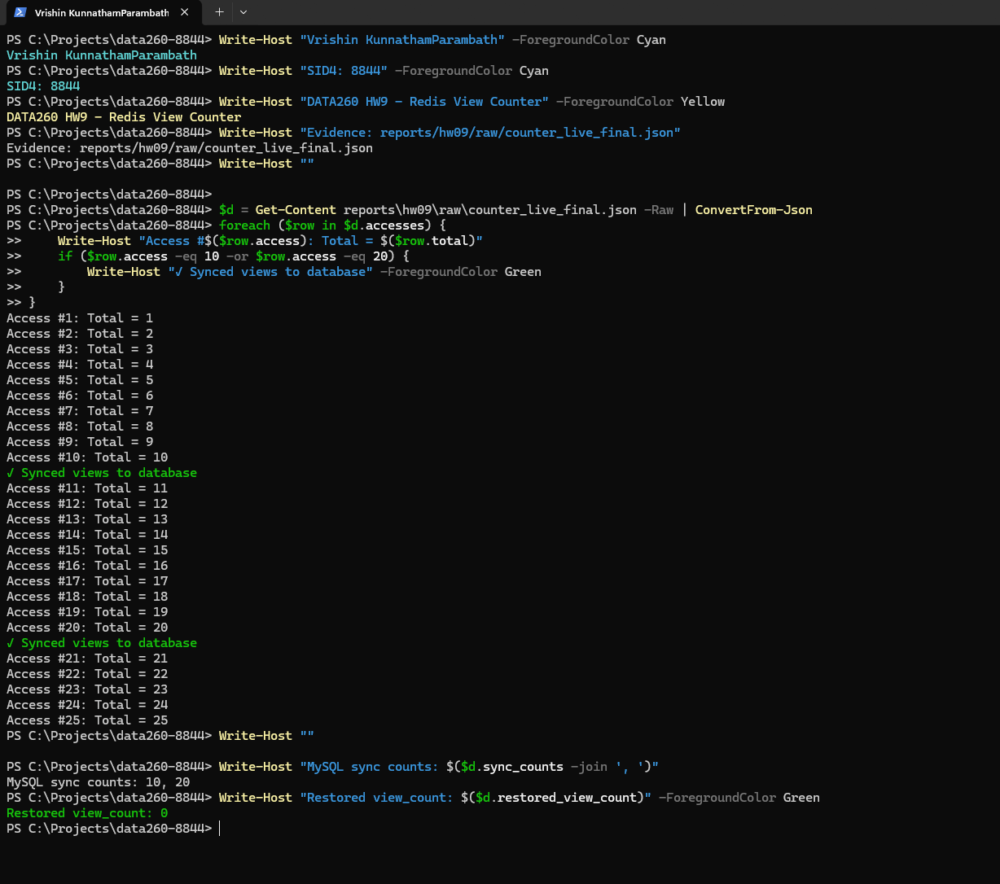
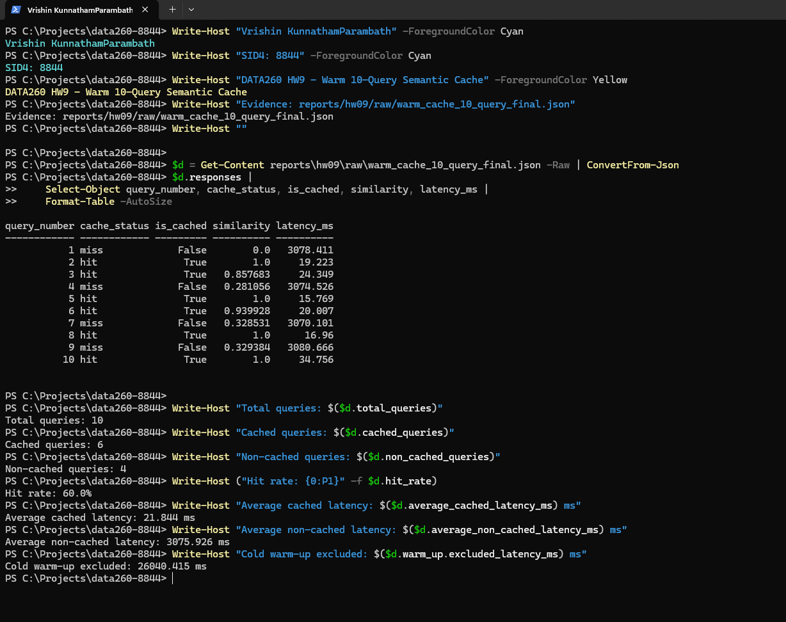
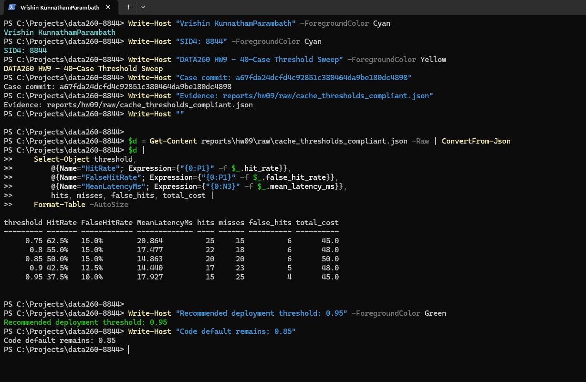
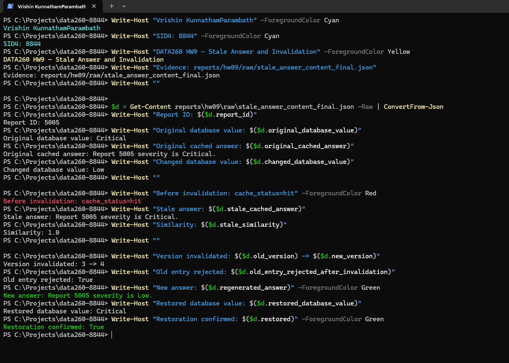
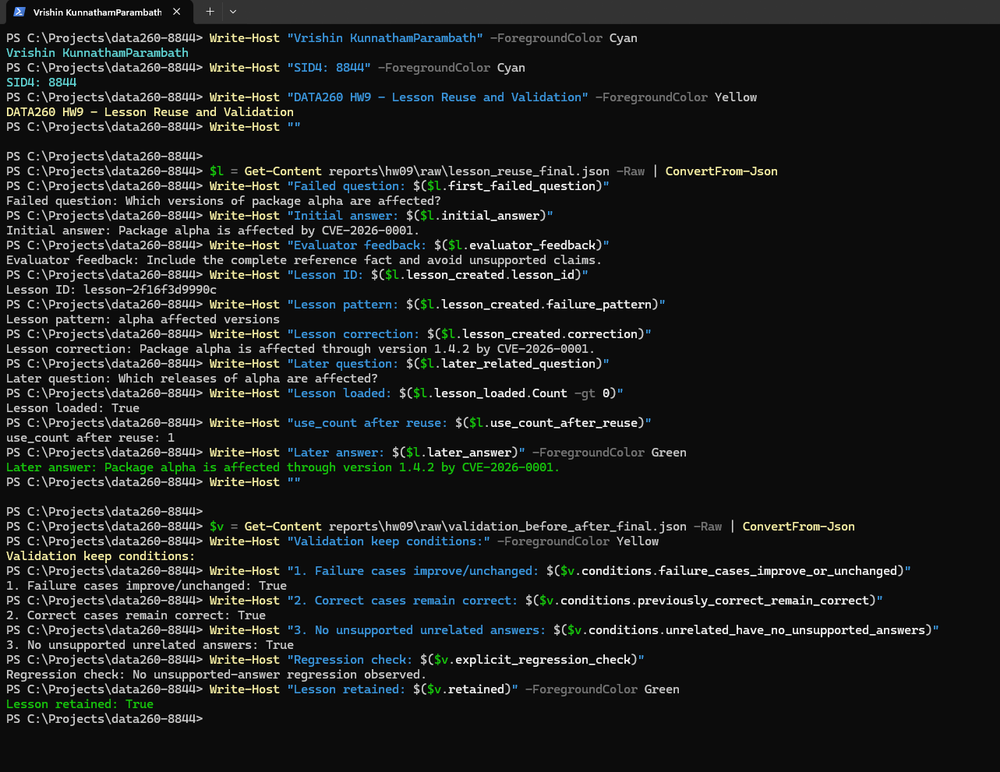
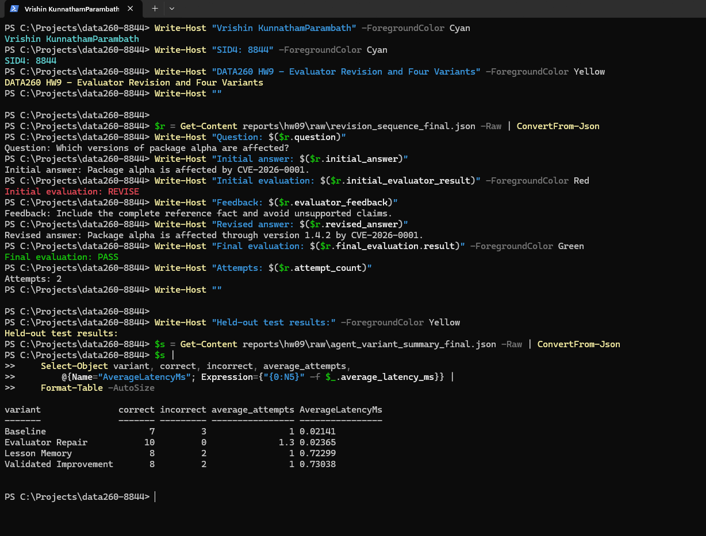

<style>
@page { size: Letter; margin: 0.7in; }
body { font-family: Arial, sans-serif; font-size: 11pt; line-height: 1.30; color: #111; }
h1 { font-size: 14pt; } h2 { font-size: 12pt; page-break-after: avoid; }
h3 { font-size: 11pt; page-break-after: avoid; }
p { margin: 0 0 7px; }
ul { margin-top: 4px; margin-bottom: 8px; }
table { border-collapse: collapse; width: 100%; font-size: 9.5pt; }
th, td { border: 1px solid #777; padding: 4px 6px; vertical-align: top; }
pre { background: #f4f4f4; border: 1px solid #ccc; padding: 8px; white-space: pre-wrap; font-size: 9pt; page-break-inside: avoid; }
code { font-family: Consolas, monospace; }
img { display: block; max-width: 100%; height: auto; margin: 10px auto 4px; page-break-inside: avoid; }
.figure-caption { text-align: center; font-size: 9pt; font-style: italic; margin: 0 0 12px; }
</style>

# DATA260 Homework 9 — Caching and Self-Improving Agents

**Student:** Vrishin KunnathamParambath<br>
**SID4:** 8844<br>
**Domain:** Open-source package vulnerabilities<br>
**Repository:** [https://github.com/Viki2183/data260-8844](https://github.com/Viki2183/data260-8844)<br>
**Branch:** `hw6-development`<br>
**Submission tag:** `hw9`<br>
**Final tagged tree:** [https://github.com/Viki2183/data260-8844/tree/hw9](https://github.com/Viki2183/data260-8844/tree/hw9)<br>
**Canonical PDF:** `reports/hw09/KunnathamParambath_HW9.pdf`<br>
**Configuration:** `PREFIX=s8844`, `PORT_BASE=8744`, `SEED=8844`, `VERIFY_SEED=268844`, `DOMAIN_ID=4`<br>
**Database/model:** MySQL `s8844_rel`; local Ollama `qwen3:8b`

## Verification boundary

HW9 extends the existing FastAPI/MySQL/JWT and HW8 Kafka application. The new authenticated `POST /api/agent/ask` endpoint checks Redis before publishing one request to `s8844_inbox`, then waits for the matching correlation ID on `s8844_final`. Existing Planner, Writer, Reviewer, entity worker, commit, retry, dead-letter, and topic behavior was not changed.

Live evidence was produced on November 8, 2026 after Docker Desktop was restarted. Redis Stack, MySQL, Kafka, and the endpoint were exercised live. The HW8 agent pipeline is deterministic; its miss responses are not claimed to be generated by Ollama. Ollama `qwen3:8b` was independently loaded and warmed, and the embedding model is `sentence-transformers/all-MiniLM-L6-v2`. Part 4 is also a deterministic reference-grounded experiment, stated plainly below.

## Part 1 – Redis View Counter

The real `VulnerabilityReportDB`/`vulnerability_reports` entity receives `view_count`. Every access uses Redis `INCR`; every tenth count is committed and refreshed through the existing SQLAlchemy session.

```python
key = make_key("views:vulnerability_report", report_id)  # s8844:...
current = int(self.redis.incr(key))
if current % 10 == 0:
    report.view_count = current
    db.commit()
    db.refresh(report)
    print("Synced views to database")
return current
```

The migration preflight reported `vulnerability_reports.view_count already exists`. A reversible live run selected report `5005`, set the test baseline to zero, exercised accesses 1–25, and restored its original value.

```text
Access #1: Total = 1
Access #2: Total = 2
...
Access #10: Total = 10
✓ Synced views to database
...
Access #20: Total = 20
✓ Synced views to database
...
Access #25: Total = 25
```

MySQL held 10 at access 10 and 20 at access 20; Redis reached 25. The original database value and report-specific Redis key were restored/removed. Evidence: `raw/counter_live_final.json`.



<p class="figure-caption">Figure 1. Counter results: accesses 1–25; MySQL sync at 10 and 20; restored value 0. The high-resolution original visibly includes Vrishin KunnathamParambath and SID4 8844.</p>

## Part 2 – Semantic Response Cache

### Authenticated ingress and response contract

The route uses the existing HW7 Bearer dependency, so reader, writer, and moderator identities retain existing role behavior. The response contains `answer`, `is_cached`, `similarity`, `latency_ms`, `cache_status`, `correlation_id`, and component `timings_ms`. A hit returns before Kafka; a miss uses the unchanged HW8 producer-side path.

Historical live endpoint evidence remains reproducible: the first request missed at similarity `0.0` in `36,177.985 ms`; its exact duplicate hit at `1.0` in `24.930 ms`; the paraphrase hit at `0.93005` in `72.601 ms`; and a different query missed at `0.489112` in `3,197.389 ms`.

The first request included cold local embedding/model initialization. It is retained as cold-start evidence and excluded from the warm 10-query averages. Authentication returned 401 without a token and 200 for all three roles. Matching correlation ID `live-match-8844` survived unrelated final messages. A stopped Reviewer returned 504 at the bounded timeout; unavailable Kafka returned 503; both were restored. Evidence: `raw/endpoint_live.json`.

### Redis vector index

The corrected overlay uses `redis/redis-stack-server:7.4.0-v8`. Startup calls idempotent `FT.INFO`/`FT.CREATE` for `s8844:semantic_cache:index`, indexing HASH entries under `s8844:semantic_cache:entry:` with a 384-dimensional normalized `FLOAT32` HNSW/COSINE vector. Lookup uses `FT.SEARCH ... KNN` and converts cosine distance to similarity.

```python
embedding = embed_text(question)  # normalized MiniLM vector
current_version = current_or_recorded_version(db, report_id, redis)
candidate, similarity = cache.lookup(question, embedding, current_version, report_id)
if candidate is not None and similarity >= threshold:
    print(f"HW9 semantic cache hit similarity={similarity:.6f}")
    return AgentAskResponse(answer=candidate["answer"], is_cached=True, ...)
print(f"HW9 semantic cache miss similarity={similarity:.6f}")
return AgentAskResponse(answer=agent_answer, is_cached=False, ...)
```

Live `MODULE LIST` reported RediSearch `2.10.20`. The vector check created the index, inserted two entries, returned the intended candidate at similarity `1.0`, and rejected an orthogonal candidate at `0.0`. Evidence: `raw/vector_index_live_final.json`. The set scan is retained only inside the explicitly marked offline fake, not production.

### Warm 10-query experiment

Ollama `qwen3:8b` was loaded with a one-token warm request. One authenticated endpoint warm-up then loaded the app embedding path; its `26,040.415 ms` latency was excluded. After deleting only HW9 semantic-entry keys, ten timed requests included exact duplicates, paraphrases, and new questions.

| Metric | Live result |
|---|---:|
| Total queries | 10 |
| Cached | 6 |
| Non-cached | 4 |
| Overall hit rate | 60.0% |
| Average cached latency | 21.844 ms |
| Average non-cached latency | 3,075.926 ms |

Every response passed the seven-field contract check, including `is_cached`. Evidence: `raw/warm_cache_10_query_final.json`.

This warm experiment used the code default threshold `0.85`. Its paraphrase similarity of `0.93005` is a hit at 0.85 but would be a miss under the safer 0.95 deployment recommendation.



<p class="figure-caption">Figure 2. Warm results: 10 queries, 6 cached, 4 non-cached, 60% hit rate, 21.844 ms cached mean, and 3,075.926 ms non-cached mean. Application logs use “HW9 semantic cache hit/miss similarity=&lt;score&gt;”; the original includes student identification.</p>

## Part 3 – Threshold Economics and Stale Answers

### 3.1 Fixed-case provenance

`cases/cache_cases.yaml` contains exactly 40 input cases: 10 exact duplicates, 10 paraphrases, 10 superficially similar/different-answer cases, and 10 unrelated cases. The case file was committed on its own before the compliant rerun as commit `a67fda24dcfd4c92851c380464da9be180dc4898` at `2026-11-08T00:51:10-08:00`; SHA-256 is `4BB63A41026FF3D8A881F22014D0D2E819808FB380DC9FEACB356F10962AA7FF`. Earlier results are retained only as historical evidence. Provenance: `cases/cache_cases_provenance.json`.

### 3.2 Compliant threshold sweep

The same committed cases and ten seed entries were run independently through the live Redis vector index at each threshold.

| Threshold | Hit rate | False-hit rate | Mean latency (ms) | Total cost |
|---:|---:|---:|---:|---:|
| 0.75 | 62.5% | 15.0% | 20.864 | 45 |
| 0.80 | 55.0% | 15.0% | 17.477 | 48 |
| 0.85 | 50.0% | 15.0% | 14.863 | 50 |
| 0.90 | 42.5% | 12.5% | 14.440 | 48 |
| 0.95 | 37.5% | 10.0% | 17.927 | 45 |

Evidence: `raw/cache_thresholds_compliant.json`.



<p class="figure-caption">Figure 3. Five-threshold results: costs 45/48/50/48/45; 0.95 has 10% false hits and is recommended. The original includes the case-file commit and student identification.</p>

### 3.3 Complete false hit

- Cached query: “Which versions of package alpha are affected by CVE-2026-0001?”
- Incoming query: “Which versions of package alpha are fixed by CVE-2026-1001?”
- Similarity: `0.951798081398`
- Cached answer returned: “Package alpha is affected through version 1.4.2 by CVE-2026-0001.”
- Correct answer: “CVE-2026-1001 fixes package alpha in version 1.5.0.”
- Explanation: the embedding emphasized shared package, version, and vulnerability wording while underweighting both the changed CVE identifier and affected-versus-fixed relation.

The correct fact was added to the separate reference dataset before the final rerun. Evidence: `raw/false_hit_compliant.json`.

### 3.4 Cost model and shipping threshold

`total_cost = misses × 1 + false_hits × 5`. A miss costs one comparison unit because it consumes the normal Kafka/agent execution while still returning a fresh result. A false hit costs five because an incorrect vulnerability answer can lead a user to believe an unsafe version is safe or to identify the wrong affected/fixed release, requiring investigation and support correction. The weights are transparent risk-comparison units, not dollars.

Thresholds 0.75 and 0.95 tie at cost 45. The deployment recommendation is **0.95**, because it reduces false hits from 6 to 4 even though hit rate falls from 62.5% to 37.5%. This deliberately trades away some correct paraphrase hits—including the observed `0.93005` paraphrase—to reduce the risk of confidently wrong vulnerability answers. The code default intentionally remains `0.85`; deployment should set `HW9_SEMANTIC_THRESHOLD=0.95`.

### 3.5 Stale answer and invalidation

The reversible live demonstration used report 5005 and changed a real content field:

| Step | Observed value/result |
|---|---|
| Original database severity | Critical |
| Original cached answer | “Report 5005 severity is Critical.” |
| Changed database severity | Low |
| Query before invalidation | hit; stale “Critical” answer |
| Version change | 3 → 4 |
| Old entry after invalidation | rejected |
| Regenerated answer | “Report 5005 severity is Low.” |
| Restoration | severity restored to Critical |

```python
version = current_or_recorded_version(db, report_id, redis)
cached, score = cache.lookup(question, embedding, version, report_id)
# After the report update:
new_version = invalidate_report_version(report_id, redis)  # atomic INCR
cached, score = cache.lookup(question, embedding, str(new_version), report_id)
```

Evidence: `raw/stale_answer_content_final.json`. Explicit versions make the stale-hit behavior observable and invalidation cheap, but writers must increment the version. Protection currently applies only to report-scoped requests carrying `report_id`; unscoped questions need a broader entity/dependency-version strategy.



<p class="figure-caption">Figure 4. Stale-answer results: Critical changed to Low, stale Critical hit observed, version 3→4 invalidated, Low regenerated, and Critical restored; the original includes student identification.</p>

## Part 4 – Self-Improving Multi-Agent System

### Design and data

Part 4 is a deterministic, reference-grounded two-agent experiment so outcomes are reproducible; it is not represented as LLM inference. Baseline failures are injected through `baseline_failure` and `incomplete_fact` fields in the reference data so the assignment-permitted controlled repair path can be demonstrated reliably.

- **Communication:** the Answering Agent returns an answer; the Evaluator returns `PASS` or `REVISE` plus feedback; only the Answering Agent produces the revision.
- **Lesson reuse:** relevant saved lessons are loaded before answering and increment `use_count` when selected.
- **Stopping condition:** one initial answer plus at most one feedback-driven revision, for two attempts total.
- **Validation:** retain a candidate only when failures do not worsen, correct answers remain correct, and unrelated answers remain grounded.
- **Limitation:** deterministic retrieval, injected failures, small hand-built datasets, and simple token-overlap lesson matching limit generalization.

```python
answer = answering_agent.answer(question, lessons=loaded_lessons, attempt=1)
evaluation = evaluate(question, answer, reference)
if evaluation["result"] == "REVISE" and attempts < 2:
    answer = answering_agent.answer(
        question, lessons=loaded_lessons, attempt=2,
        feedback=evaluation["feedback"],
    )
    evaluation = evaluate(question, answer, reference)
```

The evaluator supplies feedback but does not become the answering agent. The second answer is produced by `AnsweringAgent.answer`, which retrieves the applicable reference fact again and uses the feedback to correct the identified omission.

```python
def answer(self, question, lessons=None, attempt=1, feedback=None):
    facts = retrieve_facts(question, self.reference)
    applicable = [lesson for lesson in (lessons or [])
                  if fact_matches_lesson(facts[0], lesson)]
    if applicable:
        return applicable[0]["correction"]
    if facts[0].get("baseline_failure"):
        if attempt == 1:
            return facts[0]["incomplete_fact"]
        if feedback and "complete reference fact" in feedback.lower():
            return facts[0]["fact"]
        return facts[0]["incomplete_fact"]
    return facts[0]["fact"]
```

```python
def evaluate(question, answer, reference):
    expected = retrieve_facts(question, reference)[0]
    passed = expected["fact"].lower() in answer.lower()
    return {
        "result": "PASS" if passed else "REVISE",
        "feedback": "Include the complete reference fact and avoid unsupported claims.",
        "correction": expected["fact"],  # ground truth for scoring/lessons only
    }
```

```python
keep = (
    after["failure_cases_incorrect"] <= before["failure_cases_incorrect"]
    and after["previously_correct_still_correct"]
    and after["unrelated_unsupported"] <= before["unrelated_unsupported"]
)
```

The files themselves are included in the submission tree; training/validation/test records contain only `question`, while ground truth remains separate in `reference_data.json`.

### 4.1 Complete revision sequence

- Question: “Which versions of package alpha are affected?”
- Initial answer: “Package alpha is affected by CVE-2026-0001.”
- Evaluator result: `REVISE`
- Feedback: “Include the complete reference fact and avoid unsupported claims.”
- Revised answer: “Package alpha is affected through version 1.4.2 by CVE-2026-0001.”
- Final evaluation: `PASS`
- Attempt count: 2
- Final returned response: the revised answer above.

Evidence: `raw/revision_sequence_final.json`.

### 4.2 Lesson creation and reuse

The first alpha question failed because it omitted the affected version. Lesson `lesson-2f16f3d9990c` stored failure pattern `alpha affected versions` and the complete correction. The later question “Which releases of alpha are affected?” loaded that lesson, changed `use_count` from 0 to 1, returned the complete 1.4.2/CVE answer, and evaluated `PASS`. Evidence: `raw/lesson_reuse_final.json` and `raw/lessons.json`. Earlier console artifacts `raw/agent_variants_stdout.json` and `raw/lesson_demo_stdout.json` are preserved as historical evidence.

### 4.3 Before/after validation

| Validation check | Before | After | Condition |
|---|---:|---:|---|
| Target alpha failure incorrect | 1 | 0 | passed; improved |
| Other failure cases (gamma/zeta) incorrect | 2 | 2 | passed; unchanged |
| Previously correct cases | 3 | 3 | passed; remained correct |
| Unrelated unsupported answers | 0 | 0 | passed; no regression |

All three keep conditions passed, including the explicit unsupported-answer regression check, so the alpha lesson was retained. A second controlled candidate—“Always claim package alpha is vulnerable”—was rejected because failures increased from 1 to 2, a previously correct case regressed, and unsupported unrelated answers increased from 0 to 1. The rejected candidate was evaluated in a temporary lesson store and was not retained. Evidence: `raw/validation_before_after_final.json`.



<p class="figure-caption">Figure 5. Lesson results: alpha lesson loaded, use_count became 1, all three keep conditions passed, and no unsupported regression occurred; the original includes student identification.</p>

### 4.4 Four independent variants

The final 10-question held-out file was frozen before the compliant four-variant run, was not changed between variants, and was never used to create or modify lessons. An earlier four-question pilot is retained only as historical raw evidence and is not used in this final table.

| Variant | Correct | Incorrect | Average attempts | Average latency |
|---|---:|---:|---:|---:|
| Baseline | 7 | 3 | 1.0 | 0.02010 ms |
| Evaluator Repair | 10 | 0 | 1.3 | 0.02296 ms |
| Lesson Memory | 8 | 2 | 1.0 | 0.75096 ms |
| Validated Improvement | 8 | 2 | 1.0 | 0.59373 ms |

These sub-millisecond means reflect deterministic rules, timer granularity, and local JSON access—not model generation. The small differences between Lesson Memory and Validated Improvement are run-to-run noise and do not establish a performance trend. Evaluator Repair improves all three controlled baseline failures; the single validated alpha lesson improves one repeated pattern without claiming universal improvement. Evidence: `raw/agent_variants_final.json` and `raw/agent_variant_summary_final.json`.



<p class="figure-caption">Figure 6. Revision results: REVISE, feedback, Answering Agent revision, PASS in two attempts; final variants score 7/10, 10/10, 8/10, and 8/10. The screenshot records the same counts from an earlier timing run; the table and raw final JSON contain the latest timing-only rerun. The original includes student identification.</p>

### 4.5 Submission data excerpts

The following compact excerpts make the submitted data shapes and separation visible without reproducing full source files.

`cases/reference_data.json` (ground truth is separate from input files):

```json
[
  {"fact_id":"alpha","keywords":["alpha","cve-2026-0001","versions","affected","releases"],"fact":"Package alpha is affected through version 1.4.2 by CVE-2026-0001.","baseline_failure":true,"incomplete_fact":"Package alpha is affected by CVE-2026-0001."},
  {"fact_id":"severity-1003","keywords":["severity","cve-2026-1003"],"fact":"CVE-2026-1003 has Critical severity."},
  {"fact_id":"alpha-fix-1001","keywords":["alpha","cve-2026-1001","versions","fixed"],"fact":"CVE-2026-1001 fixes package alpha in version 1.5.0."}
]
```

`cases/training_data.json`:

```json
[{"question":"Which versions of package alpha are affected?"},
 {"question":"What mitigation is recommended for package zeta?"}]
```

`cases/validation_data.json`:

```json
[{"question":"Which releases of alpha are affected?"},
 {"question":"What is the severity of CVE-2026-0003?"},
 {"question":"What is the capital of France?"}]
```

`cases/test_data.json` (held out from lesson creation):

```json
[{"question":"Which beta releases contain CVE-2026-0002?"},
 {"question":"Which alpha versions are vulnerable?"},
 {"question":"How do I sort a list in Python?"}]
```

`raw/lessons.json` (all five required fields):

```json
[{"lesson_id":"lesson-2f16f3d9990c",
  "failure_pattern":"alpha affected versions",
  "correction":"Package alpha is affected through version 1.4.2 by CVE-2026-0001.",
  "created_at":"2026-11-08T19:05:27.579057Z",
  "use_count":1}]
```

`cases/cache_cases.yaml` uses the same query-only layout for all 40 committed cases:

```yaml
- id: exact-10
  label: exact_duplicate
  query: What mitigation is recommended for package zeta?
  cached_query: What mitigation is recommended for package zeta?
- id: paraphrase-01
  label: paraphrase
  query: What releases of alpha are vulnerable to CVE-2026-0001?
  cached_query: Which versions of package alpha are affected by CVE-2026-0001?
- id: similar-different-01
  label: superficially_similar_different_answer
  query: Which versions of package alpha are fixed by CVE-2026-1001?
  cached_query: Which versions of package alpha are affected by CVE-2026-0001?
- id: unrelated-01
  label: unrelated
  query: How do I sort a list in Python?
```

## AI_use

OpenAI Codex using a GPT-5 model provided coding assistance to audit repository conventions, inspect the official handout, draft scoped Python/Markdown changes, reason about Redis Search commands, and organize verification. The student manually reviewed the proposed file list, source diffs, authentication behavior, live command outputs, raw JSON evidence, screenshots, and final PDF, and approved the integration choices. The implementation uses local `sentence-transformers/all-MiniLM-L6-v2` embeddings and the repository’s existing deterministic HW8 Kafka agents. Ollama `qwen3:8b` was installed, loaded, and warmed during live verification, but neither the preserved HW8 pipeline nor the deterministic Part 4 variants are falsely described as Ollama-generated.

All reported Redis/MySQL/Kafka values came from real commands against local services; agent-variant values came from real deterministic executions. The migration, 25-access counter, vector KNN check, authenticated endpoint, warm query set, threshold rerun, stale-content restoration, validation, variant files, and six manually captured terminal screenshots were inspected. For PDF readability, deterministic crops remove only unused terminal space; original screenshots are preserved and no pixels or text were generated. Offline fakes were used only for unit tests and are distinguished from live evidence. No fabricated measurements, timestamps, model behavior, commit hashes, or screenshots were used.

## Limitations

- The initial Ollama warm call timed out at 180 seconds while loading; `ollama ps` then showed `qwen3:8b` loaded, and a one-token request completed. This warm-up is excluded from cache averages.
- HW8 cache-miss answers remain deterministic because changing those workers was prohibited. Ollama availability is verified separately.
- Version invalidation currently covers only report-scoped queries with `report_id`.
- Part 4 uses deterministic retrieval, hand-built reference/input datasets, and simple token-overlap lesson matching. The evaluator has access to the complete reference answer, so the 10/10 Evaluator Repair score demonstrates bounded reference-grounded repair, not general LLM self-improvement.
- Ruff is not installed, so no Ruff pass is claimed.
- The original `.venv` points to a removed Python 3.12 path. Host compilation used installed Python 3.14; the final 12-test HW9 run used the dependency-complete existing Python 3.12 application image because host Python lacks SQLAlchemy.

The report CSS explicitly sets Letter margins and 14 pt/12 pt/11 pt title, section, and body sizing. High-resolution screenshots remain available as separate PNG evidence if PDF zoom is needed.

## Conclusion

HW9 now uses real Redis Stack vector search, preserves the authenticated HW8 Kafka path, synchronizes view counts to MySQL, measures warm cache behavior and threshold economics, demonstrates a real stale content hit plus explicit invalidation/restoration, and evaluates four transparent self-improving variants. The safer deployment threshold is 0.95 while the code default remains 0.85. Functionality, raw evidence, and six genuine name-bearing terminal captures are complete.
