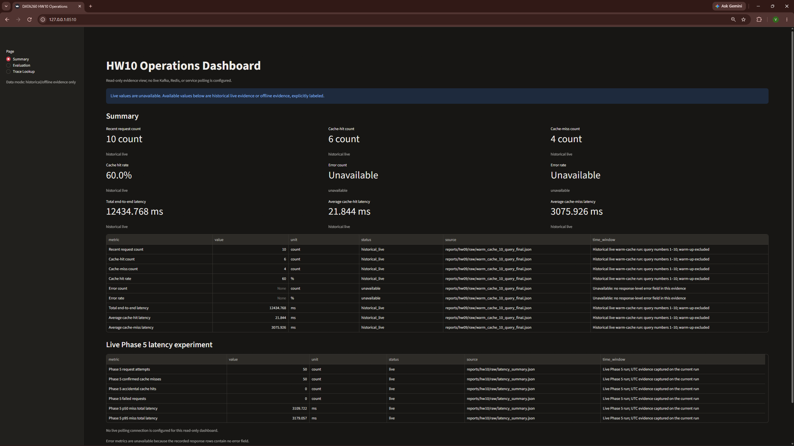
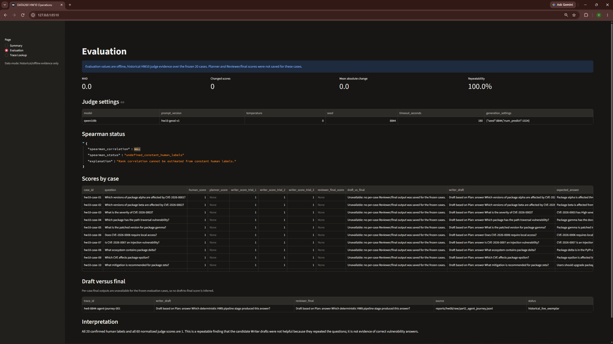
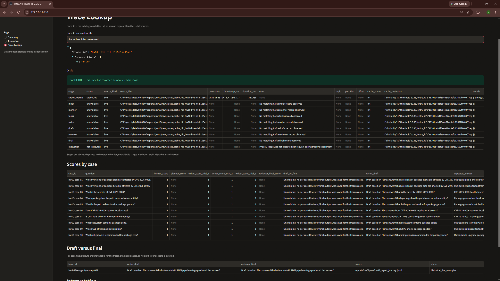
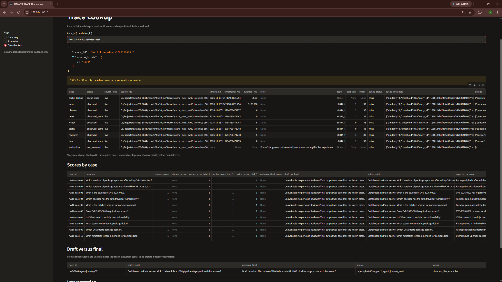
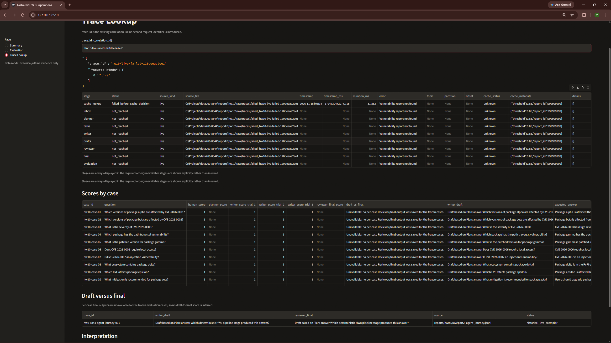



<section class="cover">
<h1>DATA260 Homework 10</h1>

Operations Dashboard, Evaluation, Tracing, and Latency

<strong>Student:</strong> Vrishin KunnathamParambath

<strong>SID4:</strong> 8844

<strong>Domain:</strong> Open-source package vulnerabilities

<strong>Repository:</strong> <code>C:\\Projects\\data260-8844</code>

<strong>Branch:</strong> <code>hw6-development</code>

<strong>Continuity:</strong> HW10 extends the existing HW1–HW9 application and preserves the HW8 Kafka workers and HW9 semantic-cache contract.

<strong>Canonical PDF:</strong> <code>reports/hw10/report.pdf</code>

</section>

## Verification boundary

HW10 observes the existing HW8 Planner → Writer → Reviewer Kafka pipeline and the existing authenticated HW9 `/api/agent/ask` path. It adds a Streamlit operations dashboard, automated evaluation evidence, manual-label validation, distributed trace observation, and a cache-miss latency experiment. It does not add a vulnerability-analysis workflow, a second request identifier, a new Kafka business pipeline, package/version-scoped Redis analysis, or behavior changes to HW8/HW9.

The existing `correlation_id` is used directly as `trace_id`. Existing topics, envelopes, retry behavior, commits, idempotency, dead-letter behavior, cache thresholds, and endpoint semantics were not changed. Frozen inputs were not changed: `reports/hw10/eval_cases.json` and `reports/hw10/human_labels.csv`.

Every result below is labeled as **live**, **historical**, **offline**, **unavailable**, or **blocked**. Raw JSON/JSONL evidence is the source of truth for detailed values.

## 1. Introduction and HW1–HW9 continuity

HW1–HW7 established the vulnerability-report application, authentication, retrieval, agent, memory, and safety foundations. HW8 introduced Kafka-backed entity work and the Planner → Writer → Reviewer pipeline. HW9 added the authenticated semantic cache and Redis-backed view/caching behavior without replacing the existing Kafka pipeline. HW10 adds operational visibility and measurement around those existing paths.

The report conventions follow the earlier submissions: explicit student/configuration metadata, a verification boundary, part-based sections, evidence paths relative to `reports/hw10/`, concise metrics tables, a separate AI-use disclosure, a separate metrics file, and a reproducible verification record.

## 2. System architecture

The observed architecture is:

1. An authenticated request reaches the existing HW9 `POST /api/agent/ask` endpoint.
2. Redis performs the existing semantic-cache lookup using the existing threshold.
3. A cache hit returns before Kafka. A miss publishes to the existing `s8844_inbox` path.
4. The existing Planner consumes inbox work and publishes to `s8844_tasks`.
5. Existing Writer workers consume tasks and publish to `s8844_drafts`.
6. The existing Reviewer consumes drafts and publishes to `s8844_final`.
7. HW10 observers join the existing records by `correlation_id`, exposing it as `trace_id`.
8. The Streamlit dashboard reads HW10 evidence and historical HW9 evidence without inventing unavailable values.

The live successful miss trace observed the complete path `cache_lookup → inbox → planner → tasks → writer → drafts → reviewer → final`. The live hit returned from cache, so later Kafka stages were correctly marked not observed for that trace. The controlled failure stopped at validation/report lookup and returned a safe HTTP 404 for a nonexistent report.

## 3. Part 1 – Streamlit Operations Dashboard

The HW10 dashboard provides Summary, Evaluation, and Trace Lookup pages. Its read-only aggregation uses `st.cache_data` for evidence-derived data and `st.cache_resource` for reusable resources. Dynamic metrics are not represented as falsely live values when only historical or offline evidence exists.

### Summary page

The Summary page displays request/cache/latency evidence with the time window and source classification. Historical HW9 warm-cache evidence remains labeled historical; Phase 5 latency evidence is labeled live. For the Phase 5 evidence window, error rate is calculated as `failed_requests / total_requests = 0 / 50 = 0%`; stated plainly, `0 failed requests / 50 total requests = 0%`. This does not relabel the historical warm-cache dataset. The 50-request counts and latency values are **live**; the HW9 warm-cache summary is **historical**; judge-statistics aggregation and dashboard tests are **offline**; per-request evaluation latency and failed live GEval scores are **unavailable**; and the original browser URL-verification attempt and failed live judge execution are **blocked** evidence.

### Evaluation page

The Evaluation page loads the three original judge trials, frozen human labels, repeatability statistics, and model/settings without changing them. It also displays the separate live end-to-end trace, its Planner plan, Writer draft, Reviewer/final answer, and four GEval attempts. The live scores remain **unavailable** because Ollama failed during evaluation; the page does not convert an undefined Spearman result or a failed live score into zero.

### Trace Lookup page

Trace Lookup accepts a `trace_id`, which is the existing `correlation_id`. It presents stages in order: `cache_lookup`, `inbox`, `planner`, `tasks`, `writer`, `drafts`, `reviewer`, `final`, and `evaluation`. Where available it shows timestamps, duration, status, errors, Kafka topic/partition/offset, message type, and cache metadata. Cache hits and misses are visually distinguished.

### Screenshot status

An earlier screenshot attempt was blocked because the browser access host and local browser URL could not be verified. A subsequent verified local capture produced the five genuine PNG screenshots below. No HW1–HW9 screenshots were copied or reused.

### Captured dashboard screenshots

<figure class="screenshot-figure">

<figcaption><em>Figure 1. HW10 Streamlit Operations Dashboard — Summary page, showing historical/offline classifications and live Phase 5 latency evidence.</em></figcaption>
</figure>

<figure class="screenshot-figure">

<figcaption><em>Figure 2. HW10 Streamlit Operations Dashboard — Evaluation page, showing judge settings, constant-label Spearman status, and per-case scores.</em></figcaption>
</figure>

<figure class="screenshot-figure">

<figcaption><em>Figure 3. HW10 Trace Lookup — live cache-hit trace `hw10-live-hit-b1d5e1ae95ad`, with cache metadata and later stages explicitly unavailable.</em></figcaption>
</figure>

<figure class="screenshot-figure">

<figcaption><em>Figure 4. HW10 Trace Lookup — live successful cache-miss trace `hw10-live-miss-e56b8558868c`, showing the observed Kafka pipeline stages.</em></figcaption>
</figure>

<figure class="screenshot-figure">

<figcaption><em>Figure 5. HW10 Trace Lookup — live controlled failure `hw10-live-failed-120deeaa2ee1`, stopping safely at validation/report lookup with HTTP 404.</em></figcaption>
</figure>

## 4. Part 2 – Automated Kafka Pipeline Evaluation

Automated evaluation used DeepEval GEval with the local Ollama endpoint `http://127.0.0.1:11434` and model `qwen3:8b`. The same prompt version, temperature, seed/settings, timeout, and frozen 20 cases were used for all three trials.

| Setting | Observed value |
|---|---|
| Cases per trial | 20 frozen cases |
| Trials | 3 |
| Successful evaluations | 60/60 |
| Judge | DeepEval GEval through local Ollama |
| Model | `qwen3:8b` |
| Temperature | 0 |
| Seed | 8844 |
| Prompt version | `hw10-geval-v1` |
| Timeout | 180 seconds per generation |
| Score range | Integer 1–5 |

Human labels were already confirmed manually before judge execution. The same local qwen3:8b judge was run in 3 repeatability trials; each trial evaluated 20 cases. This was 3 trials of one judge, not 3 different judges. All human labels are 1/5. The automated judge also produced score 1 for every case in all three trials, for 60/60 total evaluations. MAD was 0.0. No case changed across trials; mean absolute change was 0.0, maximum absolute change was 0, and repeatability was 100%.

The result is not a deployment-readiness claim. The constant human-label vector makes rank correlation mathematically undefined: `spearman_correlation: null`, status `undefined_constant_human_labels`. The judge agrees with the fixed labels, but agreement with a constant and uniformly low label set does not establish general quality or deployment readiness.

Evidence: `raw/judge_run_1.json`, `raw/judge_run_2.json`, `raw/judge_run_3.json`, and `raw/judge_validation.json`.

### One live end-to-end evaluation attempt

Live trace ID: `hw10-live-e2e-eval-fdc655292734`.

Observed path: `cache_lookup → inbox → planner → tasks → writer → drafts → reviewer → final → evaluation`.

Evidence: `raw/end_to_end/live_evaluation_trace.json`.

The live pipeline trace succeeded through the evaluator stage, but judge execution did not complete successfully. The evaluation status is `completed_with_errors`. All four GEval criteria were attempted with local Ollama `qwen3:8b`, prompt version `hw10-live-geval-v1`, temperature 0, seed 8844, and a 180-second timeout:

- Plan Quality: **unavailable** because Ollama/CUDA initialization failed.
- Writer Helpfulness: **unavailable** because the judge timed out.
- Final Answer Helpfulness: **unavailable** because the judge timed out.
- Final-vs-Draft Improvement: **unavailable** because the required scores were unavailable.

Unavailable scores were not replaced with 0 or 1. The evaluator span is real and instrumented, but this is not a successful Part 2 quality evaluation and is not a deployment gate.

This one-trace evaluator result is evidence of the failure mode and trace propagation, not a successful quality evaluation and not a deployment gate.

## 5. Part 3 – Human-label Judge Validation

The frozen case set contains 20 existing-domain Writer-draft cases. All 20 are **offline reconstructed Writer drafts**; none is a direct live Writer observation. Only one genuine raw Writer draft was available, in `reports/hw08/raw/part2_agent_journey.jsonl`. Therefore 20 diverse genuine drafts could not be obtained. No fake drafts, template replays, reconstructed additional drafts, or relabeled frozen cases were created, and no diverse v2 set was created because doing so would require fabricating or reconstructing drafts. The separate live Writer observations are the Writer stages in the successful live miss trace `hw10-live-miss-e56b8558868c` and the new end-to-end trace `hw10-live-e2e-eval-fdc655292734`.

The student manually confirmed every helpfulness label before the automated judge ran. Every case received 1/5 with the same reason: the Writer draft repeats the question rather than providing the requested vulnerability answer. No pending labels remain. The authoritative files are `eval_cases.json` and `human_labels.csv`; they were frozen before Phase 3 and were not modified during Phase 4–6.

Evidence: `eval_cases.json`, `human_labels.csv`, and `provenance.json`.

## 6. Part 4 – Distributed Tracing and Latency

### Live traces

| Trace | Trace ID (= correlation ID) | Result | Evidence |
|---|---|---|---|
| Cache hit | `hw10-live-hit-b1d5e1ae95ad` | Live cache hit; returned before Kafka | `raw/traces/cache_hit_hw10-live-hit-b1d5e1ae95ad.json` |
| Successful cache miss | `hw10-live-miss-e56b8558868c` | Live complete miss path through final | `raw/traces/cache_miss_hw10-live-miss-e56b8558868c.json` |
| Controlled failure | `hw10-live-failed-120deeaa2ee1` | Live validation/report lookup failure; safe HTTP 404 | `raw/traces/failed_hw10-live-failed-120deeaa2ee1.json` |
| End-to-end evaluation trace | `hw10-live-e2e-eval-fdc655292734` | Live complete path plus evaluator span; four GEval attempts ended with recorded errors/timeouts | `raw/end_to_end/live_evaluation_trace.json` |

The trace index is `raw/traces/trace_index.json`. The failed trace did not stop services, corrupt Kafka, or alter Redis state. Its failure class is validation/report lookup rather than Redis, Kafka, worker, evaluator, or report corruption. The end-to-end trace includes an evaluator span with `completed_with_errors` status.

### 50 confirmed semantic-cache misses

The live experiment used 50 unique uncached inputs through the existing authenticated HW9 endpoint. Each included request had `is_cached=false` and `cache_status=miss` before inclusion. There were 50 total requests, 50 confirmed misses, 0 accidental hits, 0 failed requests, 50 included requests, and 0 excluded requests.

The duration source was `time.perf_counter_ns`; timestamps use UTC ISO-8601 `Z`. Percentiles use linear interpolation on sorted values at index `(n-1) * p / 100`. Cache lookup is the HW9 embedding plus Redis-search timing. Planner, Writer, and Reviewer boundaries are matching Kafka publication timestamps. Queue wait is the residual `max(0, agent_latency - planner - writer - reviewer)`. Evaluation timing is unavailable for the 50-request experiment because evaluation was not executed per request. The separate single-trace evaluator span is not substituted into the 50-request latency distribution.

| Stage | p50 (ms) | p95 (ms) | % of cache-miss end-to-end |
|---|---:|---:|---:|
| Cache lookup | 30.663 | 66.376 | 0.986% |
| Planner | 4.000 | 6.550 | 0.129% |
| Writer | 3.000 | 8.100 | 0.096% |
| Reviewer | 3.000 | 6.550 | 0.096% |
| Queue wait (total) | 3061.381 | 3081.447 | 98.445% |
| Evaluation | unavailable | unavailable | unavailable |

Total cache-miss latency was p50 3109.722 ms and p95 3179.057 ms. Evaluation p50 and p95 are unavailable because evaluation was not executed per latency request; no evaluation latency values were fabricated. Queue wait was the dominant observable contributor. Subject to further profiling, the first optimization target would be the Kafka pipeline wait and worker-scheduling path. This is an optimization hypothesis, not a claim that a particular worker is solely responsible.

Evidence: `raw/latency_50_cache_misses.jsonl` and `raw/latency_summary.json`. Health evidence is `raw/phase5_health.json`.

## 7. AI_use

OpenAI Codex assistance was used to inspect HW1–HW9 conventions, organize the HW10 dashboard/evidence workflow, prepare report text, and perform validation. The student manually reviewed and confirmed all 20 human helpfulness labels before the labels were frozen. DeepEval GEval was used for the original three-trial judge with local Ollama `qwen3:8b` at temperature 0, seed 8844, and prompt version `hw10-geval-v1`; the separate live trace used prompt version `hw10-live-geval-v1`.

Live results include the recorded local service health, traces, 50-request cache-miss experiment, and one live end-to-end trace. The four live evaluator attempts did not produce scores because Ollama failed or timed out; those failures are preserved. Offline results include evidence aggregation and dashboard tests. The 20 human-label cases are offline reconstructed Writer drafts, not 20 live Writer observations. No remote judge, fabricated score, fabricated timing, or fabricated screenshot was used. No deployment-readiness claim is made from the constant-label evaluation result or the failed single-trace evaluator.

## 8. Limitations

- All 20 human labels are 1/5, so Spearman rank correlation is undefined and cannot measure association.
- Human-label cases are offline reconstructed Writer drafts; only the separately identified live miss trace contains a live Writer observation.
- Only one genuine raw Writer draft was available in existing HW8/HW9 evidence; 20 diverse genuine drafts could not be obtained. The original 20-case validation therefore remains degenerate.
- MAD 0 and repeatability 100% describe agreement with a constant label vector and are not sufficient evidence for deployment. The judge should not gate deployment.
- Additional evidence needed includes varied human labels, a larger case count, genuine quality diversity, meaningful rank correlation, agreement statistics, and successful live evaluator traces.
- All four live GEval criteria were attempted but did not produce usable scores: Ollama/CUDA initialization and judge timeouts blocked scoring.
- The single live end-to-end evaluator span is instrumented and trace-linked with `completed_with_errors` status.
- Per-request evaluation was not executed during the 50-request latency run, so evaluation latency is unavailable.
- Cache-hit and cache-miss latency are not interchangeable; the table reports the cache-miss experiment only.
- The queue-wait residual includes unseparated scheduling and waiting time; further profiling is required before assigning it to one worker.
- An earlier Streamlit screenshot attempt was blocked because the browser URL could not be verified; a subsequent verified local capture produced five genuine HW10 screenshots.
- Page-by-page visual reinspection of the newly regenerated 11-page PDF was attempted but blocked because Edge launched with an application error and the browser access host was unavailable. Structural PDF checks passed; no unsupported visual no-clipping claim is made for this regenerated PDF.
- The dashboard’s historical summary metrics depend on the scope and fields available in the existing HW9 evidence.

## 9. Conclusion

HW10 provides a read-only operational view over the existing HW8/HW9 system, preserves the original degenerate GEval evidence, adds a genuine trace-linked live evaluator attempt with explicit failures, and records a 50-request confirmed cache-miss latency measurement. The strongest measured performance signal is the 98.445% p50 share attributed to residual queue wait. Diverse genuine Writer drafts were unavailable; the frozen validation set is degenerate; Spearman could not be estimated; all four live GEval criteria were attempted but did not produce usable scores; and evaluation latency was not measured for the 50-request experiment. The judge is not suitable for deployment gating based on this evidence. Additional evidence needed includes varied-quality drafts, varied human labels, a larger sample size, successful evaluator runs, meaningful agreement statistics, and complete evaluation spans.

## 10. Verification and evidence references

| Evidence | Path | Classification |
|---|---|---|
| Phase 5 health | `raw/phase5_health.json` | Live |
| Trace index | `raw/traces/trace_index.json` | Live |
| Cache-hit trace | `raw/traces/cache_hit_hw10-live-hit-b1d5e1ae95ad.json` | Live |
| Cache-miss trace | `raw/traces/cache_miss_hw10-live-miss-e56b8558868c.json` | Live |
| Failed trace | `raw/traces/failed_hw10-live-failed-120deeaa2ee1.json` | Live |
| Live end-to-end evaluator trace | `raw/end_to_end/live_evaluation_trace.json` | Live; evaluator scores blocked by recorded errors/timeouts |
| Latency records | `raw/latency_50_cache_misses.jsonl` | Live |
| Latency summary | `raw/latency_summary.json` | Live/derived from live records |
| Judge trial 1 | `raw/judge_run_1.json` | Live local judge |
| Judge trial 2 | `raw/judge_run_2.json` | Live local judge |
| Judge trial 3 | `raw/judge_run_3.json` | Live local judge |
| Judge validation | `raw/judge_validation.json` | Offline aggregation of judge evidence |
| Frozen cases | `eval_cases.json` | Frozen/offline |
| Frozen labels | `human_labels.csv` | Manual confirmation/frozen |
| Judge adapter probe | `raw/judge_adapter_probe.json` | Live compatibility probe |
| Summary screenshot | `screenshots/hw10_summary.png` | Live dashboard capture |
| Evaluation screenshot | `screenshots/hw10_evaluation.png` | Live dashboard capture |
| Cache-hit Trace Lookup screenshot | `screenshots/hw10_trace_cache_hit.png` | Live dashboard capture |
| Cache-miss Trace Lookup screenshot | `screenshots/hw10_trace_cache_miss.png` | Live dashboard capture |
| Failed Trace Lookup screenshot | `screenshots/hw10_trace_failed.png` | Live dashboard capture |

The five screenshot paths above are genuine HW10 captures. The earlier browser-URL verification failure remains documented as a historical blocked attempt; it was resolved by the subsequent verified local capture.
